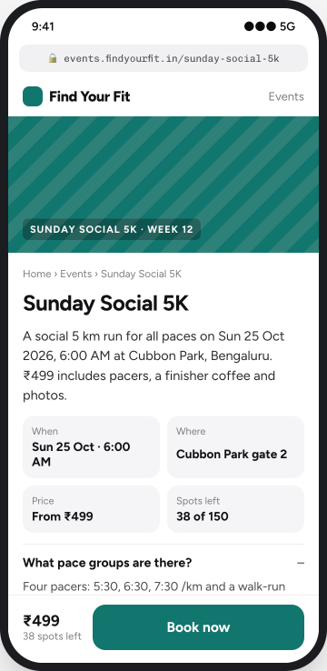
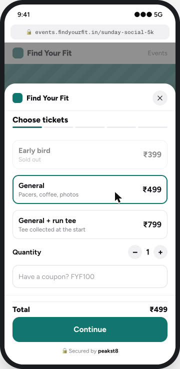
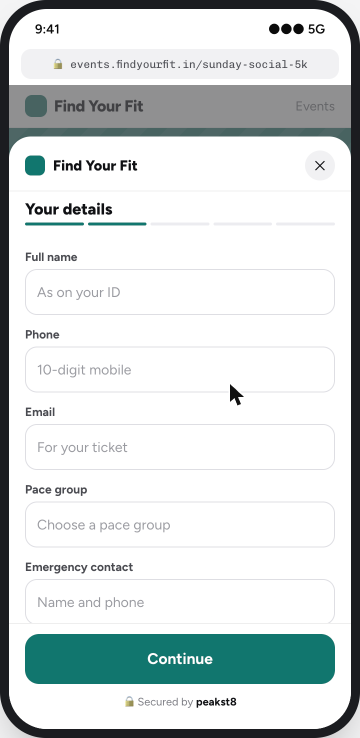
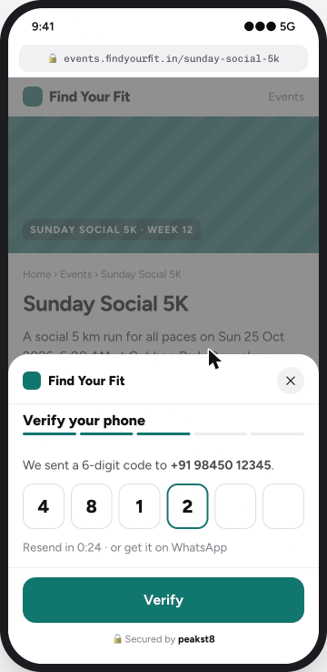
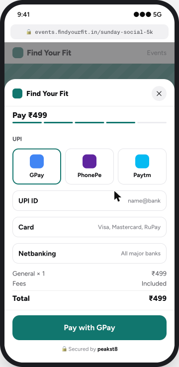
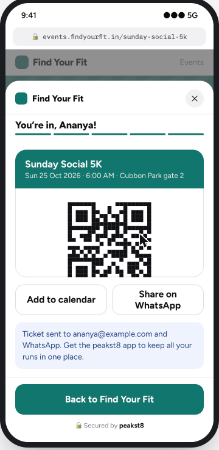
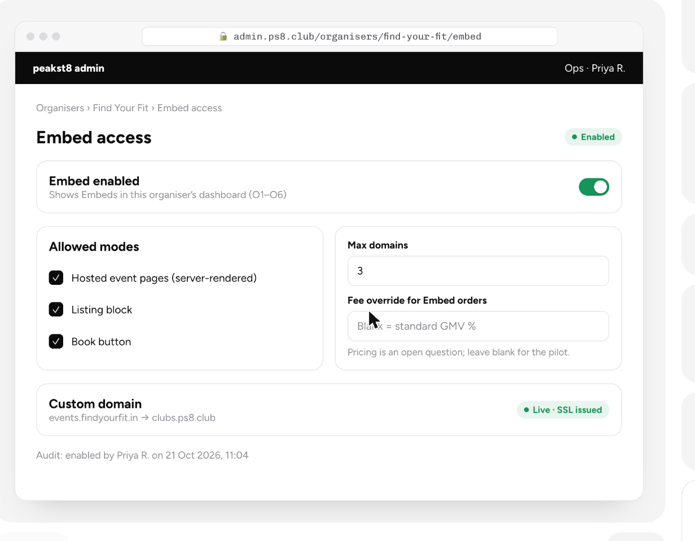
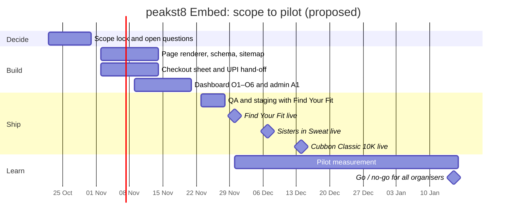

# peakst8 Embed

**A peakst8 product feature.** peakst8 Embed lets a club sell its events on its own website. Event pages rank on Google and get cited by AI answer engines on the club's domain. peakst8 still runs checkout, payments, refunds and check-in, so the GMV take is unchanged.

[Product note](https://arth6025.github.io/peakst8-embed/) · [Clickable prototype](https://arth6025.github.io/peakst8-embed/prototype/) · Internal · 22 Oct 2026

## Who we're building it for

**ICP:** community fitness organisers and event runners in Indian metros who run paid events, have a website they want to grow, and no in-house developer. Today they list on peakst8 and link out, so the search traffic never builds up on their own domain.

The pilot starts with three organisers:

| Pilot | What they run | What Embed gives them | Go-live (proposed) |
| --- | --- | --- | --- |
| **Find Your Fit** | Recurring community runs and sessions | Every run ranks on their own site; bookings without leaving it | 30 Nov 2026 |
| **Sisters in Sweat** | Women's fitness community events | Their brand all the way through checkout; one place for all their events | 7 Dec 2026 |
| **Cubbon Classic 10K** | A 10K race | A race page on their domain that ranks and gets quoted for "10K in Bengaluru" searches | 14 Dec 2026 |

## The problem

- **Traffic leaks.** Linking out to a ticketing page sends every searcher to another domain.
- **Iframe embeds are invisible.** Google credits the vendor, and AI crawlers, which mostly don't run JavaScript, see nothing.
- **No attribution.** Clubs can't fire their GA4 or Meta pixel on a booking.

## What we're building

1. **Hosted event pages** on the club's domain (`events.club.in`), server-rendered, with Event and FAQ schema, a sitemap, IndexNow pings, AI crawlers allowed and an `llms.txt`.
2. **A listing block or Book button** for the club's main site, from one snippet.
3. **One peakst8 checkout** that opens as a sheet over the club's page and sends booking events to the club's GA4 and pixel.

Embed is switched on per organiser from peakst8 admin, so the pilot stays limited to these three.

## Screens

### peakst8 dashboard (organiser)

| O1 · Embeds home | O2 · Choose mode |
| --- | --- |
|  |  |
| **O3 · Choose scope** | **O4 · Brand** |
|  |  |
| **O5 · Domain and tracking** | **O6 · Install and SEO check** |
|  |  |

### Attendee flow (on the club's site)

| E1 · Event page | E2 · Tickets | E3 · Details |
| --- | --- | --- |
|  |  |  |
| **E4 · Phone OTP** | **E5 · Payment** | **E6 · Confirmation** |
|  |  |  |

### peakst8 admin

Every state, with acceptance criteria and analytics events, is in the [prototype](https://arth6025.github.io/peakst8-embed/prototype/).

## Timeline to go live

| Gate | Date | Passes when |
| --- | --- | --- |
| Scope lock | 30 Oct | Prototype signed off, real checkout screens matched, payment gateway confirms framed checkout and UPI hand-off |
| Build complete | 20 Nov | All 13 screens built; SEO check passes 8 of 8 on staging |
| First pilot live | 30 Nov | Find Your Fit takes a real order through Embed |
| All pilots live | 14 Dec | All three organisers live, at least one order each |
| Go / no-go | 15 Jan 2027 | Embed share of pilot GMV, mobile Book-to-paid conversion, and organic plus AI-referred bookings reviewed |

## Open questions

- **Canonical:** if the club page is canonical, the peakst8 marketplace listing loses that search traffic.
- **Pricing:** same GMV % on Embed orders, or lower?
- **Data:** can clubs export attendee phone and email?
- **Payments:** does the gateway allow checkout inside a frame? This blocks the 30 Oct gate.

## In this repo

| Path | What it is |
| --- | --- |
| `index.html` | The product note, published on GitHub Pages |
| `prototype/` | Clickable prototype of all 13 V1 screens |
| `screens/` | Screenshots used in this README |
| `robots.txt`, `sitemap.xml`, `llms.txt` | Search and AI crawler files for the site |
